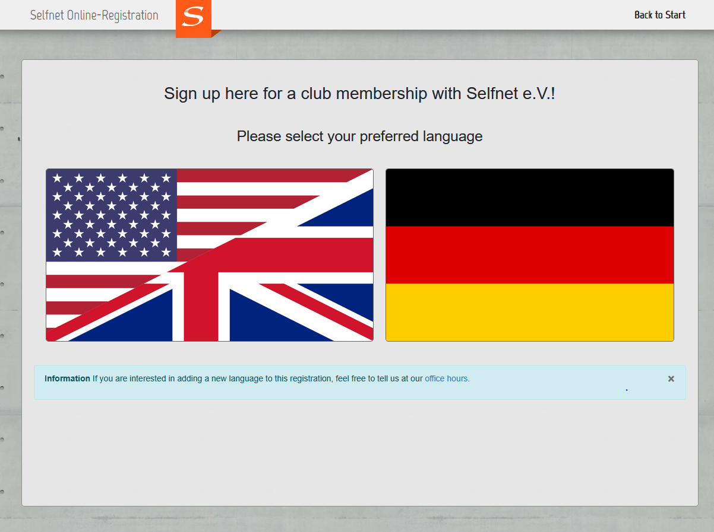
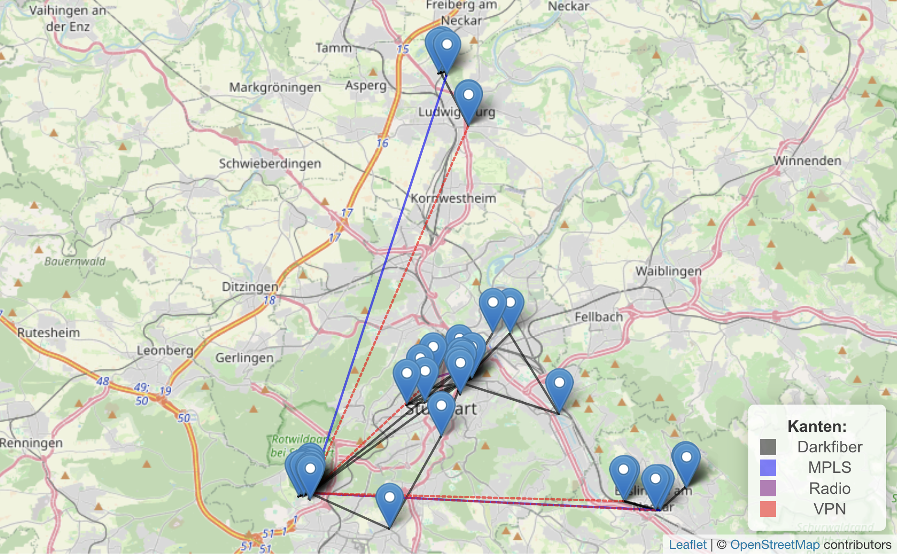
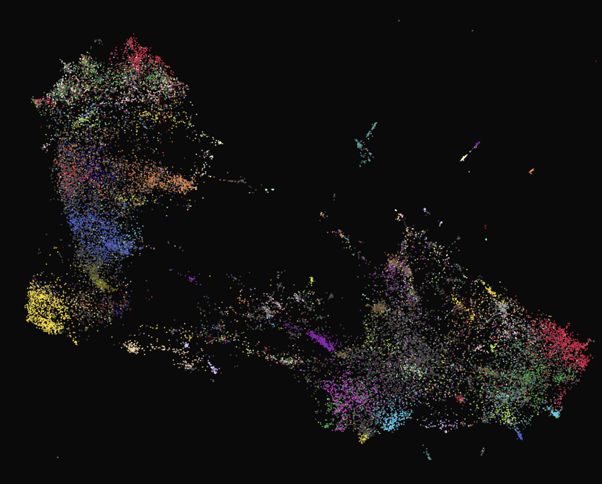

<!-- _class: lead -->
<!-- _footer: '' -->

# Netzwerken lernen,
# indem man eins betreibt

**Natalie Böhm** · Selfnet e.V.
Tag der offenen Tür

---



---

# Es fängt mit einem Kabel an

Man wird Mitglied.
Man zieht ins Wohnheim.
Steckt ein Ethernetkabel ein/Richtet Wlan ein
Bekommt **2,5 Gbit/s**.

Mehr muss man als Selfnet-Mitglied auch nie tun.

---

# Hinter dem Kabel

Ein **gemeinnütziger Verein, seit 1999** am Unicampus Vaihingen.

**7.000 Mitglieder** in Stuttgart, Ludwigsburg, Esslingen.
Zwei **20 Gbit/s** Uplinks. **~300 Switches.**

Keine Angestellten. Kein bezahltes Personal für Technik.

---

<!-- _paginate: false -->
<!-- _footer: '' -->




---
# Das Netzwerk

Darkfiber zu nahen Wohnheimen selbst gelegt
Andere Teile per gemieteten Darkfibers angebunden
MPLS-Tunnel über BelWü für entfernte Standorte.
Eine **Richtfunkstrecke mit DSL-Backup**, weil Glasfaser zu teuer war.

Switches redundant über Glasfaser an zwei Core-Router angebunden.

---

# Structuremap

https://structuremap.selfnet.de/

---
# Dashboards

https://dashboard.selfnet.de/

https://selfnet-status.de/

---

# Montag oder Donnerstag, 18 Uhr, NOC-Abend

Jemand schraubt Server-Hardware zusammen.
Ein anderer hat ein Projekt, das er deployen will.
Ein dritter debuggt per SSH einen Switch in einem Keller am anderen Ende der Stadt.
Mitglieder kommen zum persönlichen Support vorbei.

Und im Hintergrund füllt sich die Ticket-Queue.

---

<style scoped>
ul { display: grid; grid-template-columns: repeat(4, 1fr); gap: 18px; list-style: none; padding: 0; margin-top: 30px; }
li { background: #fff3ed; border-top: 6px solid #ff5a17; border-radius: 12px; padding: 18px 8px; text-align: center; font-size: 0.75em; line-height: 1.3; }
li::marker { content: ''; }
li em { opacity: 0.65; font-size: 0.8em; }
</style>

# Wer macht was?

- 🌐<br>**Netzwerk**<br>_Router, BGP, IPv6_
- 🏗️<br>**Bauleitung**<br>_Kabel, Racks, Wohnheime_
- 📊<br>**Verwaltung**<br>_Finanzen, Einkauf_
- 📣<br>**PR mit SWS & VSSW**<br>_Partner, Events_
- 🎯<br>**Mitgliederakquise**<br>_Neue Gesichter_
- 🧑‍💻<br>**Programmierung**<br>_Python, Tools_
- 🖥️<br>**Infrastruktur**<br>_Kubernetes, Ceph_
- 🍳<br>**Kochen**<br>_Ohne Essen kein Hack_

---


# 35.000 Support-Tickets in 5 Jahren

`support@selfnet.de` → Request Tracker

Kein Spamfilter. Absichtlich.
Man will keine Hilferufe von Nutzern wegfiltern.

---

# Sprachen



Deutsch, Englisch, machmal auch Chinesisch

Unsere Mitglieder kommen von überall.
Und ihre Mails und Mail-Konten auch.

---

# Freitag, 24. Januar 2020, 7:20 Uhr

Das Core-Netz fällt komplett aus. Es ist ein **Freitag**.

Der Router ist nicht tot. OSPF bleibt oben, Failover greift nicht.
99% CPU. Core Dumps. Läuft kurz, crasht wieder.

---

# Freitag, 24. Januar 2020, 7:20 Uhr

Das Core-Netz fällt komplett aus. Es ist ein **Freitag**.

Der Router ist nicht tot. OSPF bleibt oben, Failover greift nicht.
99% CPU. Core Dumps. Läuft kurz, crasht wieder.

```
dc-pfe: Scheduler Oinker
```

Das Control Plane war wie ein Zombie: irgendwie tot, aber eben nicht ganz.
Juniper-Case aufgemacht. **67 Tage** und **80+ E-Mails** beginnen.

---

# Woche 2

Juniper Support:
> I have tried to figure out a root cause for this behaviour,
> but no luck so far.

---

# Woche 2

Juniper Support:
> I have tried to figure out a root cause for this behaviour,
> but no luck so far.

Am selben Tag, von Selfnet:
> Furthermore we seem to have found the issue
> that caused our problems.

---

# `kill_core.py`

> Attached is another small python3/scapy script that just
> generated a packet on my laptop, sent it through my wifi,
> through the internet to our EX core switch, and sure enough
> it took down the whole network.

---

# `kill_core.py`

> Attached is another small python3/scapy script that just
> generated a packet on my laptop, sent it through my wifi,
> through the internet to our EX core switch, and sure enough
> it took down the whole network.

Der pcap mit dem "Beweismaterial" hieß `rip-of-death.pcapng`.

---

# Der **JuRIPer**-Bug

Selfnet hat die Root Cause gefunden. 6 Firmware-Versionen bisected.
Exploit und Reproduktions-Script geschickt.

---

# Der **JuRIPer**-Bug

Selfnet hat die Root Cause gefunden. 6 Firmware-Versionen bisected.
Exploit und Reproduktions-Script geschickt.

> The information regarding the trigger or cause
> is confidential, and can't be disclosed.

Fix über **14 JunOS-Versionen**. In Junipers "stable" **Firmware**.

---

# Selfnet in a Nutshell

| | |
|---|---|
| Firewall-Regeln | **200.000+** nftables-Regeln, autogeneriert |
| DHCP-Config | **700.000 Zeilen**, 6.800 Subnetze |
| Switches | **~300** an 30 Wohnheimstandorten |
| Storage | **100 TiB** Ceph-Cluster, 3 Standorte |
| DNS | BGP-Anycast-Resolver |

Alles generiert aus **einer PostgreSQL-Datenbank**.

---

# L3 by Design

Jeder Nutzer bekommt ein **/28-Subnetz**. Nicht eine IP - ein Subnetz.

Alle Geräte NATten auf **eine externe IPv4**.
Statisches Mapping. Kein Connection-Logging nötig.

So können wir Abuse zuordnen, ohne zu beobachten, was Leute tun.

---

# Alle Switches tauschen

**260 Switches.** 30 Wohnheimstandorte. 6 Städte.

5 Hersteller evaluiert. 12 Monate getestet.
Dann: **12 Monate physischer Austausch.**

Von Ehrenamtlichen. In ihrer Freizeit.
Zwischen Klausuren.

---

# Der Switch-Tausch

**30+ Freiwillige** namentlich im Wiki erfasst.
**48 Switches an einem einzigen Tag** in Rossneckar.
**9 Leute, 10 Switches** im AXA an einem Nachmittag.

Pro Tausch: Bewohner anschreiben, jede Faser fotografieren,
Hardware tauschen, ARP-Tabellen prüfen, Datenbank updaten,
Host-Keys einsammeln. Wiederholen.

---

# Ehrenamtliche ¡Arbeit!

Ratten in den Schränken.
Dead-on-Arrival Hardware.
Switches physisch zu lang für die Racks.
Gebäudekabel zu kurz gelegt.
Halterungen von Hand schweißen.

> Da wir alle ehrenamtlich arbeiten, kann man
> leider keinen festen Zeitplan definieren.

---

# Proudly Made without Cloud

"Wir suchen Ehrenämtler, keine Fachkräfte."
≠ immer die einfachsten Wege

Keine Cloudprodukte in der Technik.
Aus Prinzip souveräne Infrastruktur.

---

# Proudly Made without Cloud

"Wir suchen Ehrenämtler, keine Fachkräfte."
≠ immer die einfachsten Wege

Keine Cloudprodukte in der Technik.
Aus Prinzip souveräne Infrastruktur.

> # **Ey, du bist bei Selfnet, nicht auf der Arbeit. Mach das mal richtig.**

---

# Die Selfnet Aktivenschaft

Ohne unsere aktiven Mitglieder würde das Netz nicht mehr laufen.

---

# Das bekommst du bei uns

🌱 **Bei Null starten**: Kein Vorwissen nötig, wir lernen gemeinsam
🚀 **Echte Technik**: Netzwerk, Kubernetes, Ceph, Virtualisierung
🎁 **Vorteile**: Vertragsverlängerung im Wohnheim, Zertifikat für den Lebenslauf
💡 **Eigene Ideen**: Projekte mit der Community umsetzen und im großen Maßstab testen
🤝 **Community**: Motivierte Leute, Freundschaften, Netzwerk
🍕 **Gute Zeiten**: Hacken, Events (z. B. SNT), Essen und Trinken gratis

---

# Nicht nur IT!

🌐 **Infrastruktur**: Netzwerk, Server, Kubernetes, Ceph, Hardware
🧑‍💻 **Entwicklung**: Tools und Services mit Python und Web-Technologien
📣 **Community & PR**: Social Media, Events, Kommunikation
📊 **Organisation**: Projektmanagement, Finanzen, Einkauf, Verwaltung

> Neugierig? Komm zur **Sprechstunde** in der Allmandring 8a oder schreib an **support@selfnet.de**

---

<!-- _class: lead -->
<!-- _paginate: false -->

# Netzwerken lernen,
# indem man eins betreibt

selfnet.de · natalie@selfnet.de · nach Leon Amtmann 

